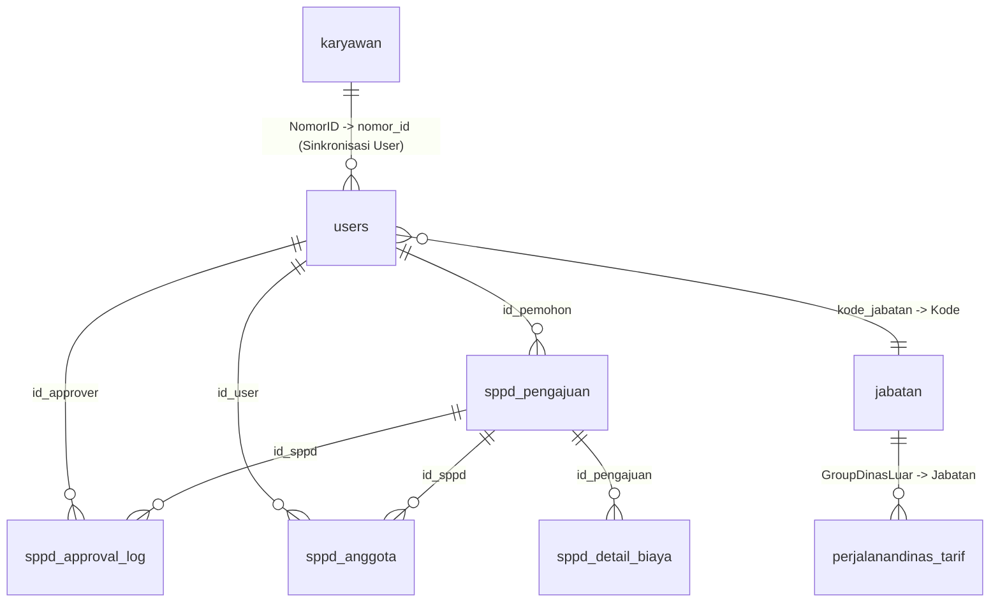

# Informasi Database dan Tabel - Proyek SIPADIN
> **Sistem Pengajuan Perjalanan Dinas (SIPADIN v2.0) — PT Adiprima Suraprinta**  
> *Laporan Pemeriksaan & Inventarisasi Database Proyek*  
> *Tanggal Pemeriksaan: 26 Oktober 2026*

---

## 1. Ringkasan Eksekutif

Berdasarkan analisis konfigurasi environment (`.env`), kode sumber backend Go (GORM), serta inspeksi langsung ke SQL Server instance (`localhost:1433`), proyek ini melibatkan **2 Database (Katalog)** pada 1 instance Microsoft SQL Server:

| No | Nama Database | Status & Peran di Proyek | Jumlah Tabel | Total Estimasi Baris |
|---|---|---|:---:|:---:|
| 1 | **`adi_perdin`** | **Database Utama SIPADIN** (Koneksi default aplikasi, penyimpanan transaksi SPPD, otentikasi user aktif, log persetujuan, ledger keuangan, master tarif, jam operasional & spesial akses) | **12 Tabel** | **283 baris** |
| 2 | **`adi_persons`** | **Database Master HR / Personalia** (Database referensi eksternal perusahaan untuk sinkronisasi master karyawan 1 perusahaan) | **1 Tabel** | **1.271 baris** |
| **Total** | **2 Database** | | **13 Tabel** | **1.554 baris** |

---

## 2. Rincian Database 1: `adi_perdin` (Database Utama Aplikasi)

* **Tipe Engine**: Microsoft SQL Server
* **Koneksi**: Dikonfigurasi di file `.env` (`DB_NAME=adi_perdin`, Port `1433`, User `sa`)
* **Peran**: Menampung seluruh data operasional sistem SIPADIN, baik tabel baru (v2.0) maupun tabel master/legacy tarif perjalanan dinas.
* **Jumlah Tabel**: **12 Tabel**

### Daftar Tabel di Database `adi_perdin`:

| No | Nama Tabel | Tipe | Jumlah Baris | Fungsi & Keterangan |
|:---:|---|:---:|:---:|---|
| 1 | **`users`** | BASE TABLE | 46 | Master akun user SIPADIN (ID, Nomor ID/NIK, Nama, Departemen, Jabatan, Role Sistem, Password Hash, No WA, Status Aktif). |
| 2 | **`sppd_pengajuan`** | BASE TABLE | 0 | Master dokumen transaksi pengajuan SPPD (Tujuan, Maksud, Tanggal, Jam, Durasi, Transport, Estimasi Biaya, Plafon, Status Dokumen). |
| 3 | **`sppd_approval_log`** | BASE TABLE | 72 | Riwayat & audit trail alur persetujuan SPPD (Manager, HRGA, Direksi, Finance) beserta catatan dan timestamp. |
| 4 | **`sppd_anggota`** | BASE TABLE | 36 | Data personil rombongan/rekan dinas yang ikut dalam SPPD beserta alokasi uang saku/makan per anggota. |
| 5 | **`sppd_detail_biaya`** | BASE TABLE | 57 | *Audit Financial Snapshot Ledger* — rekaman snapshot keuangan per orang yang bersifat permanen (*immutable*) saat disetujui. |
| 6 | **`jabatan`** | BASE TABLE | 31 | Master data jabatan perusahaan yang memetakan `Kode` jabatan ke `GroupDinasLuar` untuk menentukan plafon dinas. |
| 7 | **`perjalanandinas_tarif`** | BASE TABLE | 29 | Master matriks tarif plafon biaya perjalanan dinas berdasarkan kombinasi `Area` dan `Jabatan`. |
| 8 | **`perjalanandinas_fasilitas`**| BASE TABLE | 4 | Master kriteria fasilitas hak dinas (hak tiket, hotel, transport, uang makan, saku) berdasarkan kriteria perjalanan dinas. |
| 9 | **`jamOperasional`** | BASE TABLE | 7 | Master jadwal jam operasional akses sistem (hari, jamMasuk, jamSelesai, status_libur). |
| 10| **`SpesialAkses`** | BASE TABLE | 1 | Daftar user khusus yang dapat melewati pembatasan jam operasional sistem (id_user, nik_pendek, nama_lengkap, password_hash). |
| 11| **`perjalanandinas`** | BASE TABLE | 0 | Tabel transaksi sistem dinas legacy PT Adiprima Suraprinta sebelum SIPADIN v2.0. |
| 12| **`perjalanandinas_karyawan`** | BASE TABLE | 0 | Tabel rincian karyawan dinas legacy sebelum SIPADIN v2.0. |

---

### Struktur Kolom Tabel Utama di `adi_perdin`:

#### A. Tabel `users` (46 rows)
* `id_user` (bigint, PK, IDENTITY) — ID unik user internal sistem
* `nomor_id` (varchar(50), NOT NULL) — Nomor ID karyawan induk (contoh: `00708533542`)
* `nik_pendek` (varchar(50), NULL) — 5 digit terakhir Nomor ID untuk login cepat (contoh: `33542`)
* `nama_lengkap` (varchar(128), NOT NULL) — Nama lengkap karyawan
* `kode_departemen` (varchar(16), NULL) — Kode departemen (HRGA, FIN, PROD, MGT, dll.)
* `kode_jabatan` (varchar(16), NULL) — Kode jabatan karyawan
* `role_sistem` (varchar(20), NOT NULL) — Role: `Karyawan`, `Manager`, `HRGA`, `Finance`, `Direksi`
* `no_whatsapp` (varchar(20), NULL) — Nomor WhatsApp untuk notifikasi gateway
* `password_hash` (varchar(255), NOT NULL) — Password akun login
* `status_aktif` (tinyint, NULL) — Status aktif user (`1` = aktif, `0` = non-aktif)

#### B. Tabel `sppd_pengajuan` (0 rows)
* `id_sppd` (bigint, PK, IDENTITY) — Nomor referensi unik dokumen SPPD
* `no_sppd` (varchar(50), NULL) — Nomor surat dinas resmi (contoh: `SPPD/2026/10/0001`)
* `id_pemohon` (bigint, NOT NULL) — Relasi ke `users.id_user`
* `kota_tujuan` (varchar(100), NOT NULL) & `instansi_tujuan` (varchar(150), NOT NULL)
* `maksud_tujuan` (varchar(max), NOT NULL) — Deskripsi tugas dinas
* `tgl_berangkat` (date, NOT NULL) & `tgl_kembali` (date, NOT NULL)
* `jam_berangkat` (varchar(10)) & `jam_kembali` (varchar(10))
* `durasi_hari` (bigint) & `durasi_jam` (decimal(10,2)) & `jarak_km` (decimal(10,2))
* `transportasi` (varchar(50)) & `akomodasi` (varchar(50))
* Komponen Biaya Real: `biaya_makan`, `biaya_transport`, `biaya_uang_saku`, `biaya_tiket`, `biaya_hotel` (decimal(20,4))
* Komponen Batas Plafon: `plafon_makan`, `plafon_transport`, `plafon_uang_saku`, `plafon_tiket`, `plafon_hotel` (decimal(20,4))
* `status_plafon` (varchar(50)) — `SESUAI` atau `MELEBIHI`
* `estimasi_biaya` (decimal(20,4)) & `rincian_biaya` (varchar(max))
* `lampiran_file` (varchar(255))
* `status_dokumen` (varchar(50)) — Status persetujuan: `draft`, `menunggu_manager`, `menunggu_hrga`, `menunggu_direksi`, `disetujui`, `ditolak`, `selesai`
* `created_at` (datetimeoffset)

#### C. Tabel `sppd_approval_log` (72 rows)
* `id_log` (bigint, PK, IDENTITY)
* `id_sppd` (bigint, NOT NULL) — Relasi ke `sppd_pengajuan.id_sppd`
* `tahap_approval` (varchar(50), NOT NULL) — `Manager`, `HRGA`, `Direksi`, `Finance`
* `id_approver` (bigint, NOT NULL) — Relasi ke `users.id_user` yang melakukan approval
* `status_tindakan` (varchar(20), NOT NULL) — `DISETUJUI`, `DITOLAK`, `REVISI`
* `catatan` (varchar(max)) — Alasan penolakan / revisi / catatan approver
* `tgl_tindakan` (datetimeoffset)

#### D. Tabel `sppd_anggota` (36 rows)
* `id_anggota` (bigint, PK, IDENTITY)
* `id_sppd` (bigint, NOT NULL) — Relasi ke `sppd_pengajuan.id_sppd`
* `id_user` (bigint, NOT NULL) — Relasi ke `users.id_user` personil rombongan
* `kriteria_fasilitas` (varchar(50))
* `uang_makan` (decimal(20,4)) & `uang_saku` (decimal(20,4))

#### E. Tabel `sppd_detail_biaya` (57 rows)
* `id_detail` (bigint, PK, IDENTITY)
* `id_pengajuan` (bigint, NOT NULL) — Relasi ke `sppd_pengajuan.id_sppd`
* `id_karyawan` (nvarchar(50), NOT NULL)
* `role_personil` (nvarchar(20), NOT NULL) — `Pemohon` / `Anggota`
* `snapshot_nama` (nvarchar(128)) & `snapshot_jabatan` (nvarchar(100))
* `snapshot_grup_dinas` (nvarchar(50)) & `snapshot_tujuan` (nvarchar(255))
* `snapshot_deskripsi` (nvarchar(max))
* Nominal: `uang_makan`, `uang_saku`, `uang_hotel`, `subtotal_hak_individu` (decimal(15,2))
* `catatan_koreksi` (nvarchar(max))
* `created_at` (datetime2) & `updated_at` (datetime2)

#### F. Tabel `jabatan` (31 rows)
* `Kode` (nvarchar(10), PK) — Kode jabatan (misal: `01`, `11`, `28`, `29`)
* `Nama` (nvarchar(100)) — Nama jabatan (misal: Direktur, Manager, Staff)
* `GroupDinasLuar` (nvarchar(50)) — Kunci relasi plafon tarif (misal: `DIREKSI`, `MANAGER`, `STAFF`)
* `TanggalMulai`, `Nilai`, `NilaiShift`, `GroupKinerja`, `ProsentBonus`

#### G. Tabel `perjalanandinas_tarif` (29 rows)
* `Area` (nvarchar(50), PK) — Wilayah tujuan (misal: `JAKARTA`, `SURABAYA`, `LUAR JAWA`, `BALI`)
* `NoUrut` (decimal) — Nomor urut tampilan
* `Jabatan` (nvarchar(50), PK) — Golongan jabatan dinas (`DIREKSI`, `MANAGER`, `STAFF`, dll.)
* Plafon Fasilitas: `Transport`, `UangMakan`, `UangSaku`, `Tiket`, `Hotel` (decimal)
* `MataUang` (nvarchar(50)) — Contoh: `IDR`

#### H. Tabel `perjalanandinas_fasilitas` (4 rows)
* `Kriteria` (nvarchar(128), PK) — Kategori dinas
* `HakTransport`, `HakUangMakan`, `HakUangSaku`, `HakTiket`, `HakHotel` (smallint: 1 = Berhak, 0 = Tidak)

---

## 3. Rincian Database 2: `adi_persons` (Database Master HR)

* **Tipe Engine**: Microsoft SQL Server (instansi server yang sama)
* **Peran**: Database master HR / Personalia perusahaan PT Adiprima Suraprinta. Di codebase SIPADIN, database ini diakses via query cross-database (`adi_persons.dbo...`) untuk integrasi master karyawan.
* **Jumlah Tabel**: **1 Tabel**

### Daftar Tabel di Database `adi_persons`:

| No | Nama Tabel | Tipe | Jumlah Baris | Fungsi & Keterangan |
|:---:|---|:---:|:---:|---|
| 1 | **`karyawan`** | BASE TABLE | 1.271 | Master data personalia seluruh karyawan PT Adiprima Suraprinta (Nomor ID, Nama, Departemen, Jabatan, Rekening, Gaji, Password, Status Aktif, dll.). |

#### Struktur Kolom Utama `adi_persons.dbo.karyawan`:
* `NomorID` (nvarchar(50), PK) — Nomor induk karyawan unik (panjang hingga 11-12 karakter, sering kali diakhiri karakter whitespace/newline)
* `Nama` (nvarchar(50)) — Nama lengkap karyawan
* `KodeDepartemen` (nvarchar(16)) — Kode departemen penempatan
* `KodeJabatan` (nvarchar(16)) — Kode jabatan karyawan
* `Job` (nvarchar(50)) — Nama posisi / deskripsi pekerjaan
* `Kota` (nvarchar(32)) — Kota domisili / kantor
* `TanggalMasuk`, `TanggalKeluar`, `TanggalLahir` (datetime2)
* `Aktif` (bigint) — Status kepegawaian (1 = aktif, 0 = non-aktif)
* `Password` (nvarchar(255)) — Password bawaan master HR
* Kolom pelengkap: `Hp`, `Email`, `NamaBank`, `Norek`, `GajiPokok`, `Transport`, `UangMakan`, `Foto`, `NomorKTP`, `NomorKK`, `NomorBPJS`, dll.

---

## 4. Diagram Arsitektur Database & Relasi

---

## 5. Catatan Teknis & Temuan Audit Penting

1. **Nama Tabel Master Karyawan di `adi_persons`**:
   - Di dalam database `adi_persons`, tabel master personalia bernama **`karyawan`** (berisi 1.271 baris data).
   - Di beberapa titik kode backend ([karyawan.go](models/karyawan.go), [user_repository.go](repository/user_repository.go), [sppd_service.go](service/sppd_service.go)), query sempat mengarah ke `adi_persons.dbo.karyawan` yang menimbulkan error *Invalid object name 'adi_persons.dbo.karyawan'*. Jika ingin sinkronisasi dari `adi_persons`, query harus merujuk ke `adi_persons.dbo.karyawan`.

2. **Lokasi Tabel `jabatan`**:
   - Tabel `jabatan` (31 baris) berada di database **`adi_perdin`**, bukan di `adi_persons`. Di file [jabatan.go](models/jabatan.go) nama tabel yang benar adalah `jabatan` (di database `adi_perdin`).

3. **Operasional Login Saat Ini**:
   - Sistem login SIPADIN saat ini berjalan mandiri menggunakan tabel **`users`** di database **`adi_perdin`** (berisi 46 user lengkap dari level Karyawan, Manager, HRGA, Finance, hingga Direksi) dengan password default `123`.
